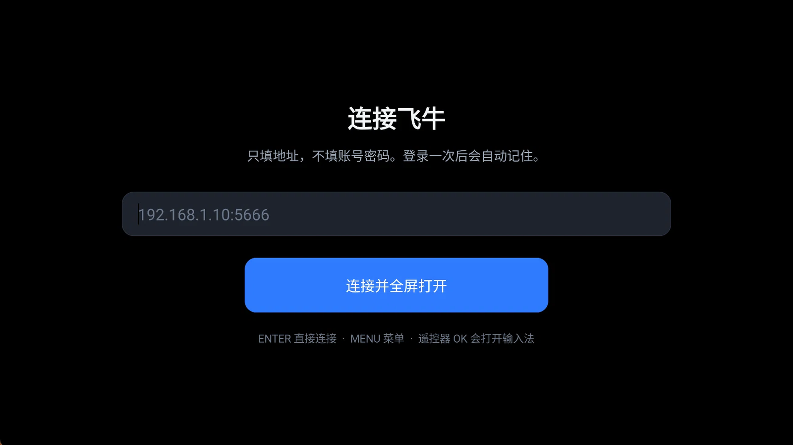
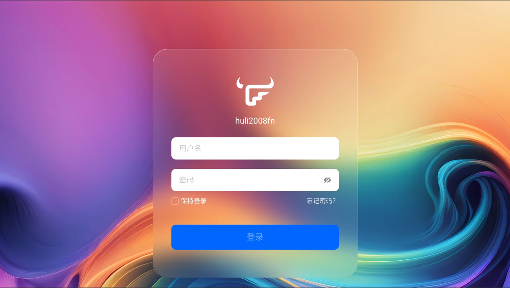

<div align="center">


# 飞牛电视浏览器 · fn TV Browser

**在电视上打开飞牛 NAS 的网页端，填一次地址，以后开机全屏直达。**

Android 7.0+ · 单文件源码 31 KB · 无第三方依赖 · MIT

</div>

---

## 它解决什么问题

飞牛 fnOS 的网页端本来就能在浏览器里用，但电视上有三个麻烦：

1. 电视浏览器没有地址栏，每次都要想办法跳转；
2. 遥控器在**鼠标式的桌面**上点不到图标（没有方向键焦点）；
3. 退出后回来，又要重新找地址。

这个 App 只做一件事：**一个全屏 WebView + 一个地址输入框**。地址记住、登录状态保持，遥控器有内置光标。

## 截图

| 首次配置：只填地址 | 飞牛登录页：登录一次即可 |
| --- | --- |
|  |  |

登录后进入飞牛桌面就是全屏的，本 App 自己的界面全部消失（`MENU` 才呼出工具条）。

## 功能

| 能力 | 说明 |
| --- | --- |
| 全屏 | 隐藏系统栏、常亮、96% 缩放防老电视过扫描裁边 |
| 记住地址 | 首次填 `192.168.1.10:5666`，之后启动直接进桌面 |
| 保持登录 | 依赖 WebView 的 Cookie / localStorage 持久化，`onPause` 主动 flush 落盘 |
| 遥控器 | 内置指针：方向键移动、`OK` 左键、长按 `MENU` 右键（桌面图标菜单）、`MENU` 短按呼出工具条 |
| 鼠标键盘 | 原生通道，未做任何拦截（硬件键盘回车正常提交表单） |
| 工具条 | 后退 / 前进 / 刷新 / 主页 / 右键 / 菜单，8 秒自动隐藏 |
| 菜单 | 修改地址、重新登录、清除缓存、指针模式开关、关于、退出 |
| 视频全屏 | 接管 `onShowCustomView`，网页播放器可全屏 |
| 免键盘配置 | `adb shell am start … --es url http://IP:5666`，或往 `files/url.txt` 写一行地址 |

## 安装

**普通 Android TV：**

```bash
adb install -r releases/fn-tv-browser-v1.1.apk
```

**TCL / 雷鸟（固件禁用了 `pm install`，报 `INSTALL_FAILED_VERIFICATION_FAILURE`）：**

这类电视不能用 `adb install`，要走电视自带的「多屏互动」通道推送：

1. `adb reverse tcp:8765 tcp:8765`；
2. 本机起一个静态服务：`python -m http.server 8765 --bind 127.0.0.1`；
3. 把多屏互动切到前台：`adb shell am start -n com.tcl.MultiScreenInteraction_TV/com.tcl.tcast.ui.activity.MainActivity`；
4. 用 T-Cast 协议推送 APK（`tcast-push.py <电视IP> http://127.0.0.1:8765/xxx.apk com.fntv.browser 飞牛电视浏览器 2`），电视上按「同意」。

> 本项目就是在这台 `tcl_mt5879_cn`（Android 11）上这样装上去并跑通的。

## 首次使用

1. 打开 App，输入 `192.168.1.10:5666`（只填 IP 会自动补 `:5666`；HTTPS 补 `:5667`）。
2. 点「连接并全屏打开」→ 飞牛登录页 → 用鼠标键盘登录一次。
3. 之后开机直接进桌面。

## 构建（无 Gradle）

`app/build.ps1` 用 Android 命令行工具直接出包，不需要 Gradle、不联网下载依赖：

```powershell
cd app
powershell -ExecutionPolicy Bypass -File build.ps1
```

链路：`aapt2 compile/link → javac(JDK17) → d8 → jar → zipalign → apksigner`。
需要 JDK 17 与 Android build-tools（脚本里改 `$tc` 指向你的 SDK 即可）。

## 已知限制

- 只支持单个地址，没有多配置切换；
- HTTPS 自签证书会弹一次「无法验证身份」，确认即可（局域网自用场景）；
- 遥控器无法「按住拖动」文件，请用右键菜单的「移动到…」；
- 网页里的 mkv / h265 直链可能黑屏，这是 WebView 编解码限制，不是 App 的问题——在飞牛影视里开启转码即可，或直接用官方「飞牛 TV」。

## 设计文档

- [设计文档（Markdown）](docs/design.md)
- [设计文档（Word）](docs/飞牛电视浏览器-极简方案-v0.4.docx)

## 许可

[MIT](LICENSE) © 2026 huli2008
