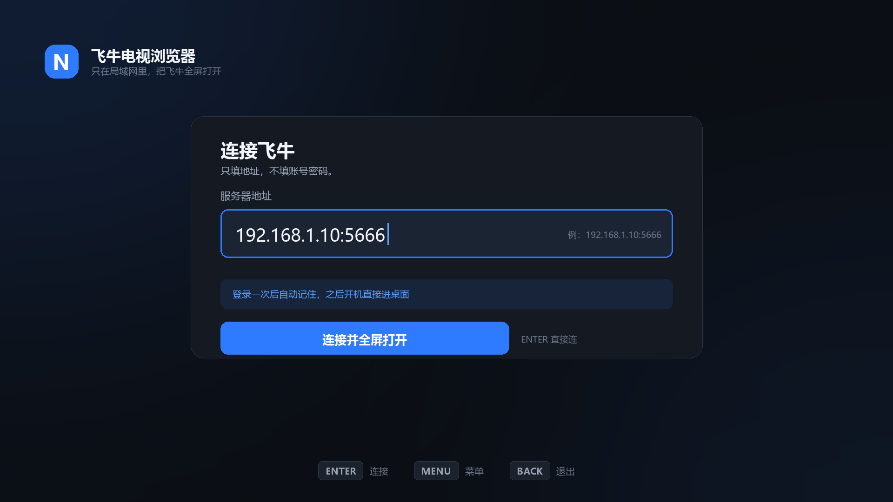
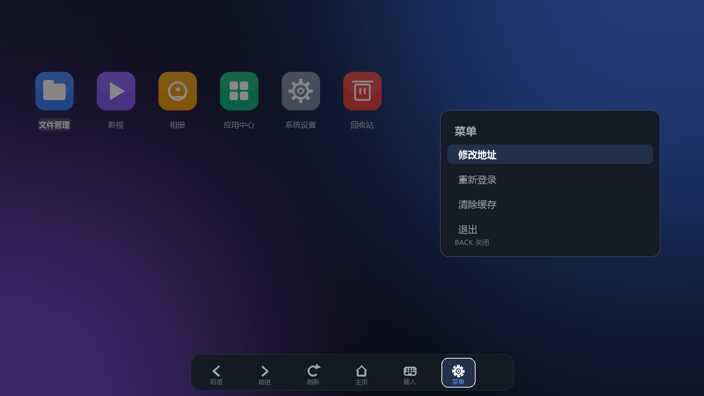

# 飞牛电视浏览器 · 极简方案（v0.4）

> 一句话：**一个全屏 WebView，填一次地址，以后开机直接进飞牛桌面。**
> 鼠标键盘直接能用，遥控器也能用，其余功能飞牛自己就有。

---

## 1. 只做三件事

| # | 做什么 | 做到什么程度 |
| --- | --- | --- |
| 1 | 全屏打开飞牛网址 | 无状态栏/导航栏，占满屏幕，屏幕常亮 |
| 2 | 记住地址、保持登录 | 第一次填 `192.168.1.10:5666`，以后启动直接进桌面，**不用再登录** |
| 3 | 能改地址 | 菜单里一项「修改地址」，改完立刻重连 |

不存密码、不做自动填表——飞牛登录一次就会保持，没必要。

---

## 2. 界面：两个屏，一个菜单

### 首次设置（只出现一次）

- **只有一个地址框**、一个「连接并全屏打开」。
- 地址栏里直接写全：`192.168.1.10:5666`。
- 之后启动不再出现这个页面。

### 全屏浏览 + 菜单

- 默认**什么都不显示**，就是飞牛桌面。
- `MENU` 键：右侧四个选项——修改地址 / 重新登录 / 清除缓存 / 退出。
- 底部工具条（后退/前进/刷新/主页/菜单）可呼出、5 秒自动隐藏。

---

## 3. 三种输入：鼠标键盘为主，遥控器加分

| 输入 | 处理方式 |
| --- | --- |
| **鼠标 / 键盘**（USB、蓝牙、飞鼠、带键盘遥控） | WebView 原生就支持，**一行代码都不用写**：点击、滚轮、悬停、打字、回车全部直接生效。外壳只做两件事——不拦截按键、不隐藏系统光标。 |
| **电视遥控器** | 内置「指针模式」（约 80 行 JS）：方向键移动光标、`OK` 左键、`MENU` 右键。 |
| **两者共存** | 检测到鼠标移动 → 注入光标自动隐藏、让位给真实鼠标；5 秒没有鼠标输入 → 注入光标恢复。互不打架。 |

关于「电视接口」：App 跑在 Android TV 上时，电视遥控器（含 HDMI-CEC 转发）的按键会直接变成 KeyEvent 送到 App，所以指针模式对遥控器同样生效，不需要额外适配。

> 指针模式可以在菜单里关掉。只用鼠标键盘时关掉最清爽，留着也不影响。

---

## 4. 实现要点（很短）

| 项 | 做法 |
| --- | --- |
| 结构 | 1 个 Activity + 1 个 WebView，没有别的页面 |
| 全屏 | 隐藏系统栏 + `FLAG_KEEP_SCREEN_ON` + 画面缩放 96% 防老电视裁边 |
| 地址存储 | `SharedPreferences` 存一行字符串，别的都不存 |
| 保持登录 | **不清 WebView 数据**：Cookie、localStorage 默认持久化，登录状态自然保持；「清除缓存」只清缓存不动登录 |
| 证书 | **不用管**：飞牛默认 HTTP 5666，不涉及证书 |
| 缩放 / UA | 保持默认，不改飞牛的任何表现 |
| 返回键 | 网页可后退就先后退，否则二次确认退出 |
| 启动 | 有地址 → 直接全屏加载，跳过设置页 |

---

## 5. 明确不做

多配置卡片、端口扫描、密码存储与自动填表、自定义遥控键盘（用系统输入法/硬件键盘）、证书信任管理、播放器接管、书签、自更新、Launcher 模式、2FA 处理、影视专项适配。

---

## 6. 工作量

**1 天**可以装到电视上跑起来：地址 + 全屏 + 菜单 + 指针模式 + 保持登录。

真机适配（TCL / 小米各一台）再留半天。

---

## 7. 结论

- 用鼠标键盘 → 这个 App 基本就是个「全屏浏览器 + 一个地址」。
- 用遥控器 → 多一段指针代码，已包含在 1 天里。
- 不用存密码，不用管证书，不用管播放——飞牛那边都有。
